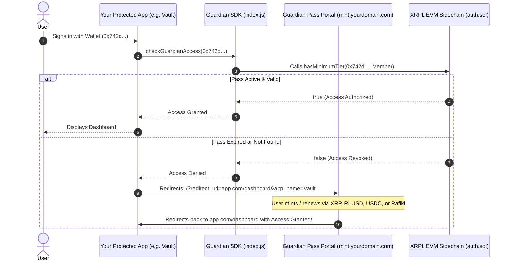

# Guardian Pass Gatekeeper Middleware & SDK

Use this lightweight SDK in **any application or backend service** to automatically check for an active Guardian Pass upon user sign-in. If the user does not hold a valid pass (or if their annual subscription has expired), it automatically redirects them to the **Guardian Pass** portal to mint or renew, and brings them back once authorized.

---

## 🚀 How It Works



---

## 🛠️ Usage in Your Applications

### 1. Backend / Node.js Express Middleware
```javascript
const express = require('express');
const { guardianGatekeeperMiddleware } = require('./gatekeeper');

const app = express();

// Protect all /dashboard routes with Guardian Pass
app.use('/dashboard', guardianGatekeeperMiddleware({
    rpcUrl: "https://rpc.testnet.xrplevm.org", // XRPL EVM Sidechain
    contractAddress: "0xYourDeployedContractAddress",
    portalUrl: "https://mint.yourdomain.com", // Your Cloudflare Pages Subdomain
    appName: "Enterprise Vault",
    requiredTier: 2 // 2 = Member Pass, 3 = VIP Pass
}));

app.get('/dashboard', (req, res) => {
    res.send(`Welcome authorized user: ${req.guardianPass.userAddress}!`);
});
```

### 2. Frontend React / Next.js Client Gate
```javascript
import { checkGuardianAccess } from './gatekeeper';

async function onUserSignIn(walletAddress) {
    const status = await checkGuardianAccess(walletAddress, {
        rpcUrl: "https://rpc.testnet.xrplevm.org",
        contractAddress: "0xYourDeployedContractAddress",
        requiredTier: 2
    });

    if (!status.authorized) {
        // Redirect to Guardian Pass portal
        const currentUrl = window.location.href;
        window.location.href = `https://mint.yourdomain.com?redirect_uri=${encodeURIComponent(currentUrl)}&app_name=DataTerminal`;
    } else {
        console.log("Access Granted!");
    }
}
```
