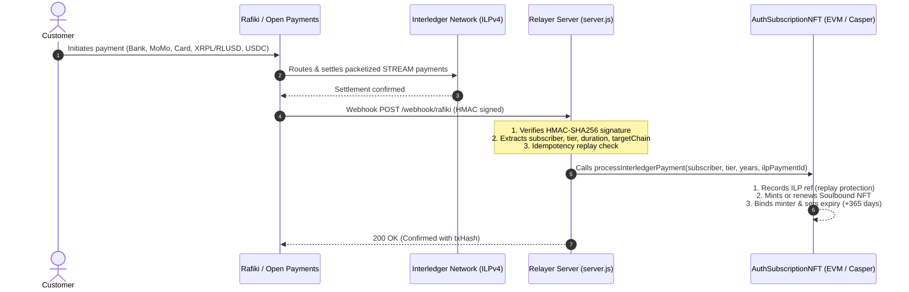

# Rafiki & ILPv4 Multi-EVM Relayer

This service connects the **Interledger Protocol (ILPv4)** and **Rafiki (Open Payments)** with the **`AuthSubscriptionNFT`** smart contract on **any EVM or Solidity-compatible network** (Casper EVM, Base, Arbitrum, Ethereum, Polygon, etc.).

---

## 🌟 How It Works



---

## 🚀 Key Advantages of Rafiki / ILPv4 with EVM

1. **Payment-Rail Agnostic:** Customers can pay via bank transfer (SEPA/ACH), mobile money, or crypto on another ledger (e.g. RLUSD on XRPL, Lightning), and ILPv4 settles it to your Rafiki wallet.
2. **True EVM Interoperability:** The relayer can dispatch the Soulbound NFT to **Casper EVM**, **Base**, **Arbitrum**, **Ethereum**, or any chain specified in the payment metadata or `.env`.
3. **On-Chain Idempotency:** The smart contract stores `processedFiatPayments[keccak256(ilpPaymentRef)]`, guaranteeing that network retries or duplicate webhook delivery will never double-mint or charge twice.
4. **Dispute & Revocation Management:** If a payment is disputed or reversed on the ILP layer, the relayer triggers `revokeAccess(tokenId, reason)` to instantly revoke credentials.

---

## 🛠️ Setup & Running

### 1. Install Dependencies
```bash
cd relayer
npm install
```

### 2. Configure Environment
Copy `.env.example` to `.env` and fill in your values:
```bash
cp .env.example .env
```
Ensure your `RELAYER_PRIVATE_KEY` address has been authorized on the smart contract by calling:
```solidity
authContract.setPaymentProvider(relayerAddress, true);
```

### 3. Start the Relayer Server
```bash
npm start
```
By default, the server listens on `http://localhost:4000`.

### 4. Test Locally with Mock Rafiki Webhook
In a separate terminal, trigger a test payment notification:
```bash
npm run test:mock
```

---

## 🔗 Open Payments Metadata Structure

When creating an **Incoming Payment** in Rafiki / Open Payments for a user subscription, attach the following JSON metadata:

```json
{
  "subscriberAddress": "0x742d35Cc6634C0532925a3b844Bc454e4438f44e",
  "tier": 2,
  "yearsCount": 1,
  "targetNetwork": "casper"
}
```

* `subscriberAddress`: The EVM address that will receive and own the Soulbound NFT.
* `tier`: 1 = Guest, 2 = Member, 3 = VIP, 4 = Admin.
* `yearsCount`: Number of years to purchase (1-10).
* `targetNetwork`: The EVM network to mint on (`casper`, `base`, `sepolia`, `ethereum`, etc.).
